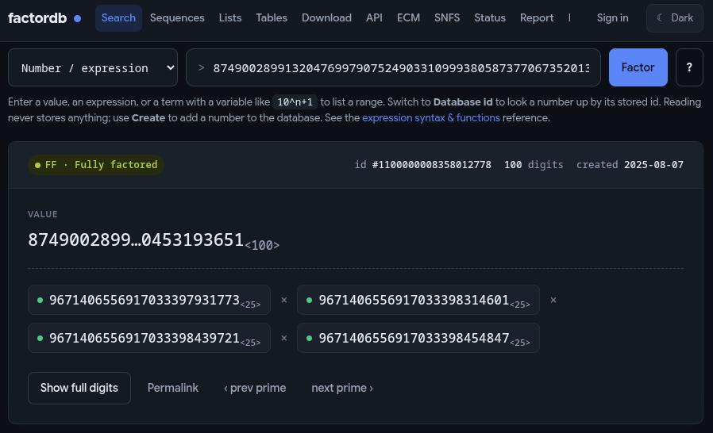
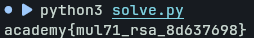

# ClusterRSA

> **Description**: A message has been encrypted using RSA, but this time something feels... more crowded than usual. Can you decrypt it?

## Overview

| Property | Detail |
| --- | --- |
| CTF | CyLab |
| Category | Crpytography |
| Difficulty | Medium |
| Files | [message.txt](https://challenge-files.cylabacademy.net/library/1a5c092f11159dc35b2cfb22ef189875d06a5024ecdaedff3172166e780d677a/message.txt) |
| Flag Format | academy{...} |

## Given Files

`message.txt`

```text
n = 8749002899132047699790752490331099938058737706735201354674975134719667510377522805717156720453193651
e = 65537
ct = 7520663091857378339007504982557120925212073399808779197116857253111013701540089607119061765329210001
```

We get the three usual RSA values: the modulus $n$, the public exponent $e$, and the ciphertext $ct$.

## RSA

Normal RSA picks **two** big primes $p$ and $q$:

$$
n = p \cdot q
$$

To decrypt we need the private key $d$, which comes from $\varphi(n)$ (Euler's totient):

$$
\begin{aligned}
\varphi(n) &= (p-1)(q-1) \\
d &= e^{-1} \bmod \varphi(n) \\
m &= ct^{\,d} \bmod n
\end{aligned}
$$

So **if we can factor $n$, we can decrypt**. RSA is only safe when $n$ is too big to factor.

## Analysis

The hint says the message feels **"more crowded than usual"**. A "crowded" $n$ suggests it's made of **more than two primes**. This is called **multi-prime RSA**.

Checking the size of $n$:

```python
>>> n.bit_length()
```

Only **333 bits** (real RSA uses 2048+). Split across several primes, each prime is small, so $n$ should be easy to factor.

## Step 1: Factor n

I pasted $n$ into an online factoring tool ([factordb.com](https://factordb.com/)). It splits into **four** primes:



There are four primes instead of two, which explains "crowded".

## Step 2: Compute $\varphi(n)$ for Multiple Primes

The totient formula extends naturally. For $n = p_1 p_2 p_3 p_4$ (all different primes):

$$
\varphi(n) = (p_1-1)(p_2-1)(p_3-1)(p_4-1)
$$

Everything else in RSA stays the same.

## Step 3: Decrypt

```python
# solve.py
from math import prod
 
n = 8749002899132047699790752490331099938058737706735201354674975134719667510377522805717156720453193651
e = 65537
ct = 7520663091857378339007504982557120925212073399808779197116857253111013701540089607119061765329210001
 
primes = [
    9671406556917033397931773,
    9671406556917033398314601,
    9671406556917033398439721,
    9671406556917033398454847,
]
assert prod(primes) == n
 
phi = prod(p - 1 for p in primes)
d = pow(e, -1, phi)
m = pow(ct, d, n)
 
print(m.to_bytes((m.bit_length() + 7) // 8, "big").decode())
```



## Flag

`academy{mul71_rsa_8d637698}`

## Lessons Learned

- More primes in the same size $n$ means **smaller primes**.
- Primes that are **close together** are dangerous.
- First steps for any RSA challenge: check `n.bit_length()` and try factordb.

## References

- [RSA (Wikipedia)](https://en.wikipedia.org/wiki/RSA_cryptosystem)
- [Euler's totient function (Wikipedia)](https://en.wikipedia.org/wiki/Euler%27s_totient_function)
- [factordb](https://factordb.com/)